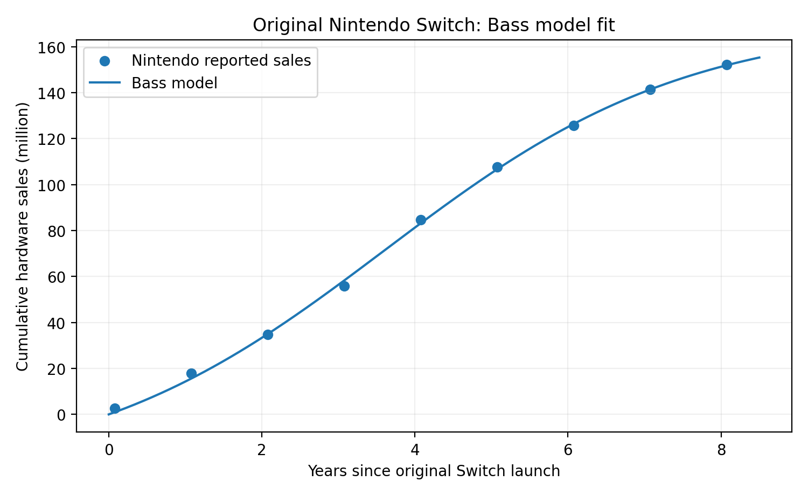
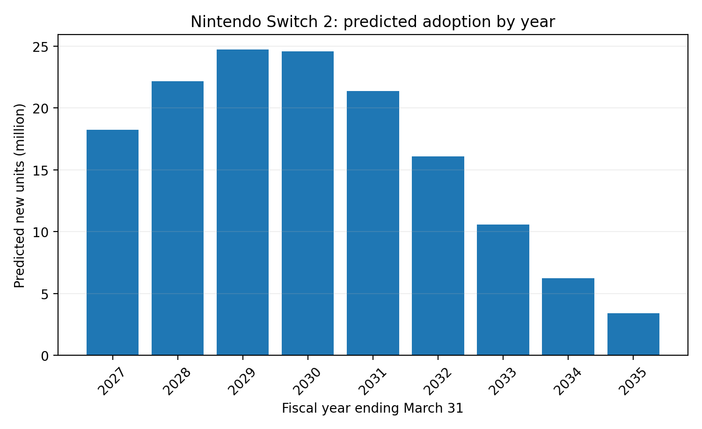

# 1. Selected innovation

**Nintendo Switch 2** was selected from TIME's Best Inventions of 2025. It is Nintendo's new hybrid console, combining handheld and TV gaming like the original Switch but with stronger hardware, a larger screen, new controllers, and additional online features [1]. Nintendo released it worldwide on June 5, 2025 [2].

**TIME link:** <https://time.com/collections/best-inventions-2025/7318303/nintendo-switch-2/>

# 2. Historical look-alike

I use the **original Nintendo Switch (2017)** as the historical look-alike. The main reason is that the two products are very close in functionality and target market. Both are hybrid consoles, use Nintendo's game ecosystem, are sold worldwide, and depend strongly on game releases, reviews, word of mouth, and other people owning the same platform. This makes the original Switch a useful historical example for how demand for Switch 2 may develop.

The obvious limitation is that Switch 2 is the direct successor, so it did not enter the market as a completely unknown product. Existing Switch owners already knew the brand and many were potential upgrade customers. I still use it because the assignment asks for a similar past innovation, and this is the closest available comparison with high-quality historical data. Research on diffusion also considers successive generations of technology, so using a predecessor as a benchmark is reasonable [4].

# 3. Data and scope

The analysis is **global** because Nintendo reports worldwide hardware sales consistently, and both consoles were launched internationally. A country-level analysis would require combining several separate datasets and would be less consistent.

For adoption, I use **hardware units sold (sell-in)** as the measurable proxy. This is not exactly the same as unique people: one household can own more than one console and some units may be replacements. However, Nintendo provides a long and consistent hardware-sales series, so it is the most practical measure for this assignment.

The historical data come from Nintendo's annual financial results [5]. The exact Nintendo source URL for every observation is also stored in `data/dataset1.csv`.

| Fiscal year ending | Annual Switch sales (m) | Cumulative sales (m) |
|---:|---:|---:|
| 2017 | 2.74 | 2.74 |
| 2018 | 15.05 | 17.79 |
| 2019 | 16.95 | 34.74 |
| 2020 | 21.03 | 55.77 |
| 2021 | 28.83 | 84.60 |
| 2022 | 23.06 | 107.66 |
| 2023 | 17.97 | 125.63 |
| 2024 | 15.70 | 141.33 |
| 2025 | 10.80 | 152.13 |

The first observation is only from the March 3, 2017 launch to March 31, so in the estimation I use the actual time since launch rather than treating it as a complete year.

# 4. Bass model estimation

The Bass model describes adoption using three parameters [3]:

- $p$: coefficient of innovation, representing adoption that happens independently of other adopters;
- $q$: coefficient of imitation, representing adoption encouraged by other users, reviews, popularity, and word of mouth;
- $M$: total market potential.

The cumulative Bass model is

$$
N(t)=M\frac{1-e^{-(p+q)t}}{1+\frac{q}{p}e^{-(p+q)t}}.
$$

I estimated the three parameters by fitting this curve to the cumulative worldwide sales of the original Nintendo Switch. The estimates are:

| Parameter | Estimate |
|---|---:|
| $p$ | 0.0701 |
| $q$ | 0.4351 |
| $M$ | 170.81 million units |

The fact that $q$ is much larger than $p$ suggests that imitation and social influence are more important than purely independent early adoption. This makes sense for a game console because demand can grow as the game library expands, friends buy the console, reviews spread, and the platform becomes more established.

{ width=65% }

The fitted curve follows the historical cumulative sales quite closely. Of course, the Bass model cannot explain specific events such as unusually successful games, holiday demand, supply problems, or changes in the economy. It is meant to describe the overall diffusion pattern.

# 5. Forecast for Nintendo Switch 2

Nintendo reported **19.86 million Switch 2 units sold by March 31, 2026** [6]. Because Switch 2 is a successor with an existing customer base, I use this actual first-year result as the starting point for the future forecast instead of pretending that Switch 2 started exactly like the original Switch.

For each following year, I use the estimated Bass parameters from the original Switch and the standard Bass adoption equation:

$$
S_t=\left(p+q\frac{N_{t-1}}{M}\right)(M-N_{t-1}),
$$

where $S_t$ is new adoption during the period and $N_{t-1}$ is cumulative adoption before that period.

| Fiscal year ending | New adopters / units (m) | Cumulative units (m) |
|---:|---:|---:|
| 2026 | 19.86 actual | 19.86 |
| 2027 | 18.22 | 38.08 |
| 2028 | 22.18 | 60.27 |
| 2029 | 24.72 | 84.99 |
| 2030 | 24.60 | 109.58 |
| 2031 | 21.38 | 130.97 |
| 2032 | 16.08 | 147.05 |
| 2033 | 10.56 | 157.62 |
| 2034 | 6.22 | 163.84 |
| 2035 | 3.40 | 167.24 |

{ width=65% }

The model predicts the strongest annual adoption around 2029-2030, followed by a gradual slowdown as the market approaches saturation. By fiscal 2035, cumulative sales are around **167 million units**, close to the estimated market potential of about 171 million.

This should be interpreted as a baseline forecast, not an exact sales prediction. Switch 2 could end up above or below the original Switch's market potential depending on price, competition, the game library, future hardware revisions, supply, and how many original Switch owners decide to upgrade.

\newpage

The main strength of this comparison is the quality of the historical data and the similarity of the two products. The main limitation is also the similarity: Switch 2 benefits from an existing Nintendo customer base and brand awareness. Using its observed first-year sales as the starting point helps account for this, but the forecast still assumes that its long-run diffusion is broadly similar to the original Switch. Hardware units are also only a proxy for adopters because one person or household can own more than one console.

# 6. Conclusion

The original Nintendo Switch provides a useful historical benchmark for forecasting Nintendo Switch 2 because the two products have similar functionality, customers, distribution, and ecosystem effects. Fitting a Bass model to the original Switch gives $p=0.0701$, $q=0.4351$, and an estimated market potential of about 170.81 million units. Starting from Switch 2's actual fiscal-2026 sales, the model predicts growth to approximately 167 million cumulative units by fiscal 2035, with annual adoption peaking near the end of the 2020s.

The forecast is not meant to predict every yearly sales shock. Its main purpose is to show the likely long-run diffusion pattern based on a closely related historical innovation.

# References

[1] TIME. (2025). *Nintendo Switch 2: The Best Inventions of 2025.* <https://time.com/collections/best-inventions-2025/7318303/nintendo-switch-2/>

[2] Nintendo Co., Ltd. (2025, June 11). *Nintendo Switch 2 Sells Over 3.5 Million Units Worldwide in First Four Days.* <https://www.nintendo.co.jp/corporate/release/en/2025/250611.html>

[3] Bass, F. M. (1969). A new product growth model for consumer durables. *Management Science, 15*(5), 215-227. <https://doi.org/10.1287/mnsc.15.5.215>

[4] Norton, J. A., & Bass, F. M. (1987). A diffusion theory model of adoption and substitution for successive generations of high-technology products. *Management Science, 33*(9), 1069-1086. <https://doi.org/10.1287/mnsc.33.9.1069>

[5] Nintendo Co., Ltd. (2017-2025). Annual financial results and hardware sales data. Exact URLs for each data point are in `data/dataset1.csv`. <https://www.nintendo.co.jp/ir/en/finance/index.html>

[6] Nintendo Co., Ltd. (2026). Fiscal year ended March 31, 2026 financial results. <https://www.nintendo.co.jp/ir/pdf/2026/260508e.pdf>
